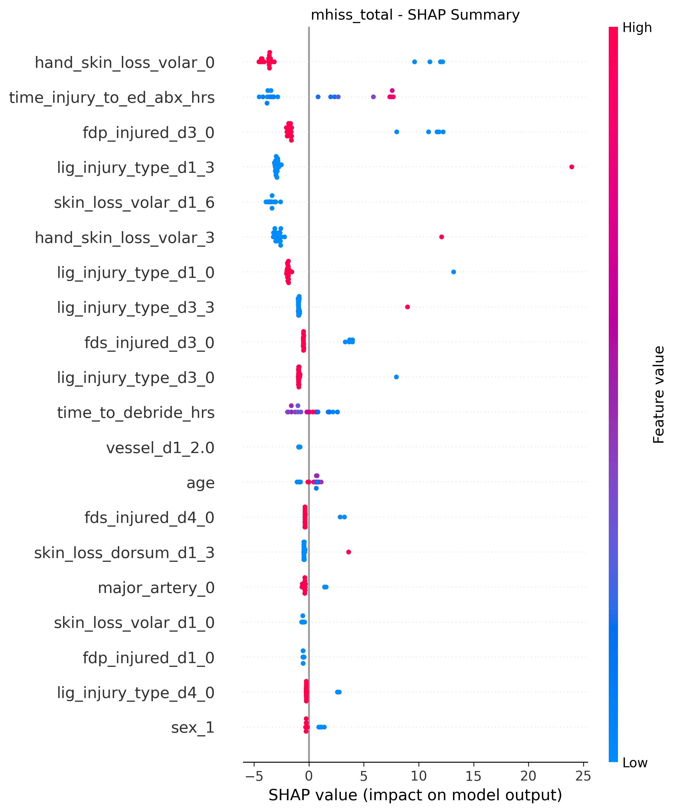

# Hand Injury AI — SHAP feature importance & AI composite score

An explainable machine-learning pipeline for traumatic hand injuries. It takes a
clinical registry workbook in which every patient has already been scored with four
established severity systems — **MHISS**, **Atthakomol**, **MUES** and **Strickland**
— and answers two questions:

1. **Task A – Which clinical findings drive each score?** A Random Forest is trained
   per score on the patients that score applies to, and SHAP values rank the
   features. Features that rank highly for two or more scores form a shortlist.
2. **Task B – Can one AI composite score summarise them?** The four scores are
   normalised and combined into a single 0–100 target, regressors are compared on
   the shortlisted features, and the resulting AI composite is checked against the
   **IPS** (Injury Prognosis Score) with scatter and Bland–Altman analysis.

The project uses the "scores-as-targets" approach described in
[`docs/technical_specification.pdf`](docs/technical_specification.pdf): validated
scoring-system outputs stand in for long-term outcomes (infection, return to work,
amputation) that need 6–12 months of follow-up.

> **Status:** research prototype trained on a 99-patient pilot cohort. The metrics
> below are pilot results, not clinical validation.

## Features

- **Bilateral → unilateral cohort building.** The workbook stores left and right hand
  findings side by side. The pipeline picks the injured side and only keeps a row when
  three independent records of the side agree (form answer, machine hand code,
  dominance-based answer), the injured side has findings and the other side has none.
  Everything else, including bilateral injuries, goes to a holdout table with reasons.
- **Clinically gated subsets.** Atthakomol is modelled only for open fractures, MUES
  only for mangled injuries (≥ 3 injured tissue domains), Strickland only for digit
  injuries.
- **Sanity gate.** A quick MHISS model must beat a mean baseline before the full SHAP
  run starts, which catches side-selection or feature-filtering mistakes early.
- **SHAP explanations.** Summary and top-5 dependence plots per score, long/wide
  rankings and a cross-score overlap table.
- **AI composite score.** Weighted MHISS 0.30, Atthakomol 0.25, Strickland 0.25,
  MUES 0.20, renormalised per patient over the scores that apply. Linear, Ridge
  (CV-tuned), Random Forest and XGBoost regressors are compared; the best is saved
  with in-sample **and** out-of-fold predictions.
- **De-identification by default.** Only the machine-readable block of the workbook
  is read, and hospital IDs are replaced by pseudonyms (keyed HMAC if you set a salt)
  before anything is written.
- **EDA artefacts.** Missing-value summary and heatmap, target distributions,
  Spearman feature–target heatmap, and range checks against the data dictionary.

## Tech stack

Python 3.11+ · pandas · scikit-learn · SHAP · XGBoost · SciPy · matplotlib/seaborn ·
openpyxl · pytest · Ruff · GitHub Actions

## Architecture

```
data/Version 2- MIT calculation table.xlsx ─┐
data/Data_Dictionary_v3.xlsx ───────────────┤
                                            ▼
                      dataset.py  load machine block, pseudonymise IDs,
                                  pick injured side, pilot vs holdout
                                            │
                            ┌───────────────┴───────────────┐
                            ▼                               ▼
                 eda.py  EDA artefacts           task_a.py  quick MHISS gate
                                                            → RF + SHAP per score
                                                            → overlap / shortlist
                                                                    │
                                                                    ▼
                                                 task_b.py  AI_target → model comparison
                                                            → best model, predictions,
                                                              AI vs IPS agreement
                                                                    │
                            pipeline.py (orchestration + run summary) ◄┘
                            summary.py  (objective-level status report)
                            cli.py      (hand-injury-ai run | task-a | task-b | summary)
```

`common.py` holds the logic both tasks share (subset flags, signal parsing,
stratification, pseudonymisation); `config.py` resolves every path from environment
variables.

## Getting started

### Prerequisites

- Python 3.11 or newer
- The two input workbooks (not included in this repository — see
  [`data/README.md`](data/README.md))

### Install

```bash
python -m venv .venv
source .venv/bin/activate          # Windows: .venv\Scripts\activate
pip install -e ".[dev]"            # or: pip install -e .  (runtime only)
cp .env.example .env               # then edit paths / salt as needed
```

Put the workbook and data dictionary in `data/` (or point the variables below at
them).

### Configuration

All settings are environment variables; a `.env` file in the project root is read
automatically (real environment variables take precedence).

| Variable | Default | Purpose |
|---|---|---|
| `HAND_INJURY_WORKBOOK_PATH` | `data/Version 2- MIT calculation table.xlsx` | Source workbook |
| `HAND_INJURY_DATA_DICTIONARY_PATH` | `data/Data_Dictionary_v3.xlsx` | Data dictionary (`Data Dictionary` sheet) |
| `HAND_INJURY_OUTPUT_DIR` | `outputs` | Generated datasets, tables and figures |
| `HAND_INJURY_REPORTS_DIR` | `reports` | Run summaries (JSON / Markdown) |
| `HAND_INJURY_FEATURE_LIST_PATH` | *(unset)* | Optional curated feature list (CSV with `feature_name`) for Task B |
| `HAND_INJURY_PATIENT_ID_SALT` | *(unset)* | Secret for keyed pseudonyms; without it IDs become `P0001`, `P0002`, … |
| `HAND_INJURY_PROJECT_ROOT` | current directory | Base for relative paths |

### Run

```bash
hand-injury-ai run              # Task A + Task B end to end (≈1 min on the pilot data)
hand-injury-ai task-a           # cohort, EDA and SHAP rankings only
hand-injury-ai task-b           # AI composite model from existing Task A outputs
hand-injury-ai summary          # objective-level status report from existing outputs
hand-injury-ai summary --run-pipeline
```

The original entry points still work: `python all_in_one_pipeline.py` (same as
`run`) and `python script.py [--run-pipeline]` (same as `summary`). Add `-v` for
debug logging. Commands exit with status 1 and a clear message when an input is
missing or the quick-model gate fails; `reports/single_file_run_summary.json`
records the status of every `run`.

### Test, lint, build

```bash
pytest                          # unit tests + synthetic end-to-end run (~40 s)
pytest -m "not slow"            # unit tests only
ruff check . && ruff format --check .
python -m build                 # wheel + sdist in dist/
```

The tests never touch real patient data: `tests/conftest.py` generates a fictional
workbook and dictionary with the same layout. CI
([`.github/workflows/ci.yml`](.github/workflows/ci.yml)) runs lint, tests with
coverage, the package build and a CLI smoke test on Python 3.11 and 3.13.

## Outputs

| Path | Contents |
|---|---|
| `outputs/pilot_model_input.csv`, `pilot_holdout_rows.csv`, `manual_side_verification.csv` | Unilateral pilot cohort, holdout rows with reasons, 10 rows for manual side checks |
| `outputs/eda/` | Row counts, missing values, anomaly report, distribution and correlation plots |
| `outputs/task_a/` | `model_performance.csv`, `feature_ranking_{long,wide}.csv`, `overlap_analysis.csv`, `default_feature_shortlist.csv`, `provisional_final_feature_list.csv`, SHAP summary and dependence plots |
| `outputs/task_b/` | `B1` model comparison · `B2` best model (joblib) · `B3` feature weights · `B4` predictions (`AI_composite` in-sample, `AI_composite_oof` out-of-fold) · `B5`/`B6` AI-vs-IPS scatter and Bland–Altman · `B7` Markdown summary |
| `reports/` | `run_summary.json` (Task A), `single_file_run_summary.json` (pipeline status), `script_objective_summary.{json,md}` |

`outputs/` and `reports/` are git-ignored: they are regenerated on every run and the
row-level files derive from patient records.

## Pilot results

From the April 2026 run on the 119-patient workbook (99 unilateral pilot rows, 20
holdout rows of which 6 bilateral). Tables are in [`docs/results/`](docs/results),
figures in [`docs/figures/`](docs/figures), and the write-ups in
[`docs/reports/`](docs/reports).

**Task A** — held-out test split (20 %):

| Score | Subset | Rows | Test metric |
|---|---|---:|---|
| MHISS total | all pilot rows | 99 | R² 0.146 |
| Atthakomol type | open fractures | 51 | weighted F1 0.284, accuracy 0.455 |
| MUES | mangled injuries | 55 | R² 0.687 |
| Strickland max | digit injuries | 76 | R² 0.256 |

Thirteen features rank in the top 15 for at least two scores; time from injury to
antibiotics, patient age and time to debridement lead the list.

**Task B** — Ridge regression was the best composite model (test R² 0.33, MAE 6.4
on the 0–100 scale; cross-validated R² 0.15).

<p>
  
  
</p>

### Limitations

- Small pilot cohort: test splits have 11–20 rows, so metrics are noisy.
- Task B selects features from Task A rankings computed on the same patients, and
  `AI_composite` in `B4` is an in-sample fit; use `AI_composite_oof` for honest
  agreement estimates.
- The AI composite (0–100) and IPS are on different scales, so Bland–Altman
  differences describe calibration as much as agreement.
- Prospective validation needs a prospective dataset with the same schema.

## Project structure

```
.
├── src/hand_injury_ai/
│   ├── cli.py            # command-line entry point
│   ├── config.py         # env-driven paths and output layout
│   ├── common.py         # shared flags, parsing, pseudonymisation
│   ├── dataset.py        # workbook/dictionary loading, cohort building
│   ├── eda.py            # exploratory artefacts
│   ├── task_a.py         # Random Forest + SHAP per score
│   ├── task_b.py         # AI composite target and model comparison
│   ├── pipeline.py       # end-to-end orchestration
│   └── summary.py        # objective-level status report
├── tests/                # pytest suite (synthetic data only)
├── data/                 # local inputs, git-ignored (see data/README.md)
├── docs/
│   ├── technical_specification.pdf
│   ├── reports/          # pilot write-ups (final report, abstract, Task A report)
│   ├── results/          # aggregate result tables from the pilot run
│   └── figures/          # selected plots from the pilot run
├── all_in_one_pipeline.py  # compatibility wrapper → hand-injury-ai run
├── script.py               # compatibility wrapper → hand-injury-ai summary
├── pyproject.toml
├── .env.example
└── .github/workflows/ci.yml
```

## Deployment

This is a batch analysis pipeline, not a service. To run it somewhere other than a
laptop (a lab workstation, a scheduled job, Google Colab), install the package with
`pip install .`, provide the two workbooks through the `HAND_INJURY_*` variables, and
run `hand-injury-ai run`; collect `outputs/` and `reports/` afterwards. Keep the
inputs and row-level outputs on storage approved for patient data, and set
`HAND_INJURY_PATIENT_ID_SALT` from a secret store rather than a committed file.

## Data protection

- Never commit the source workbook, the data dictionary, or anything under
  `outputs/`; `.gitignore` blocks spreadsheets, CSVs (except `docs/results/`),
  model pickles and generated folders.
- Pseudonyms from a salted run can be mapped back to hospital IDs only by someone
  holding the salt. Treat the salt like a password.
