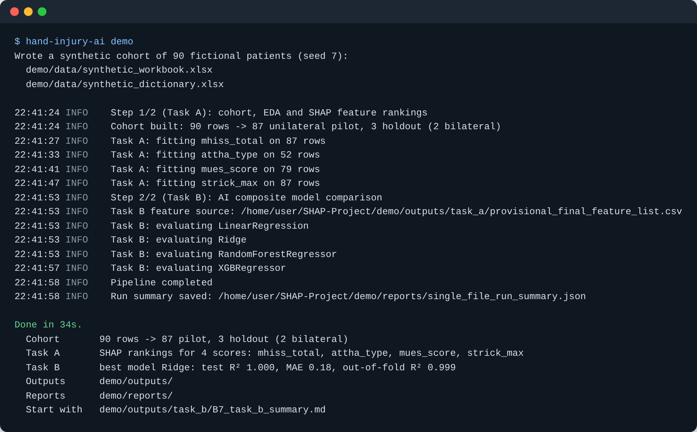
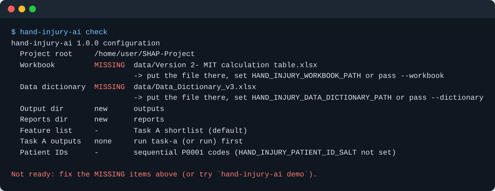
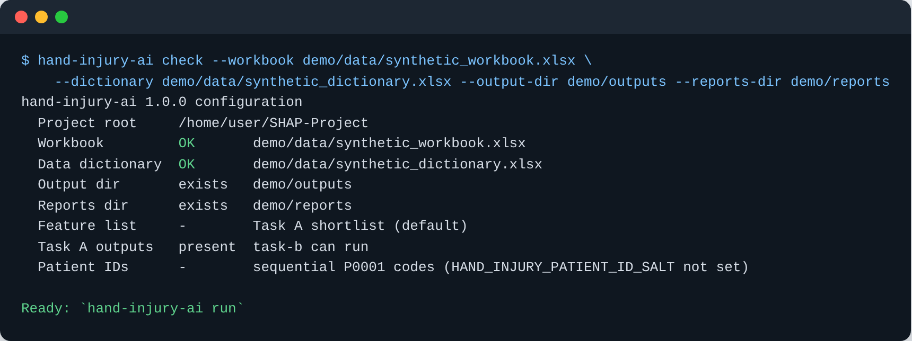
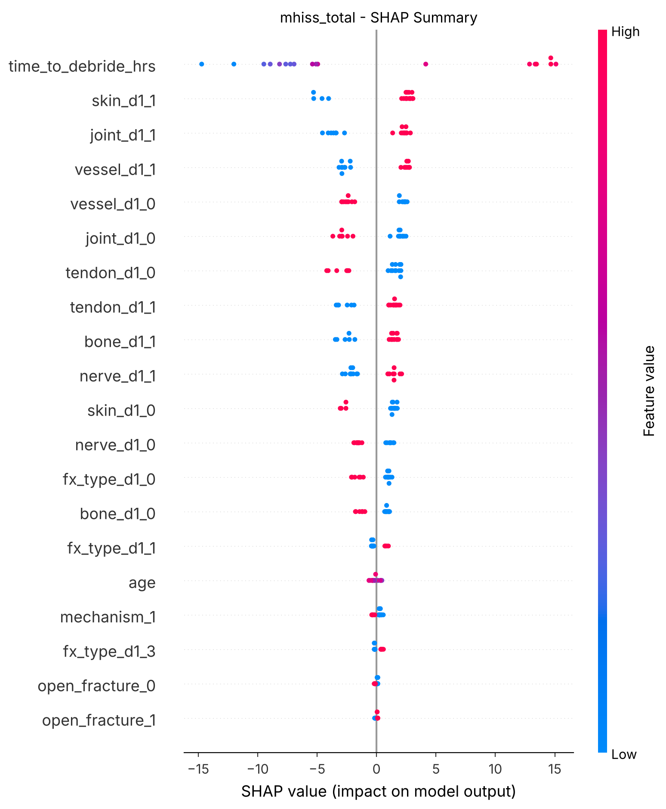
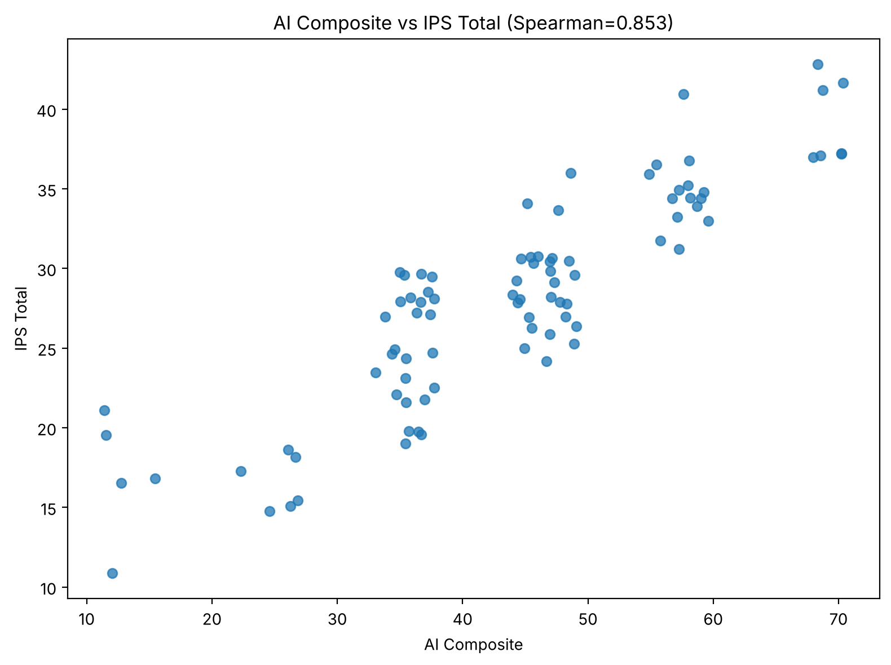
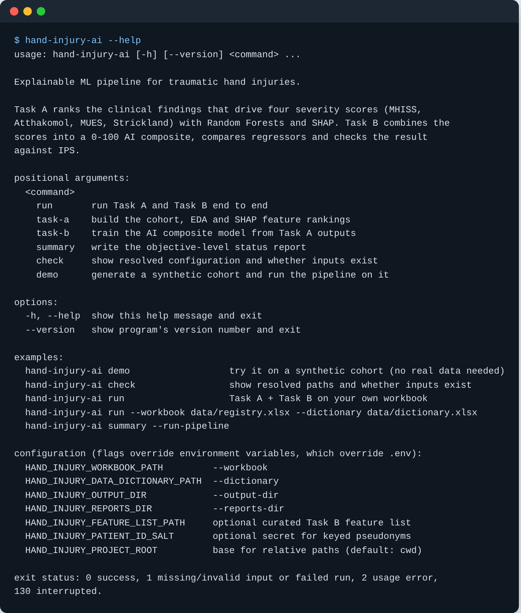
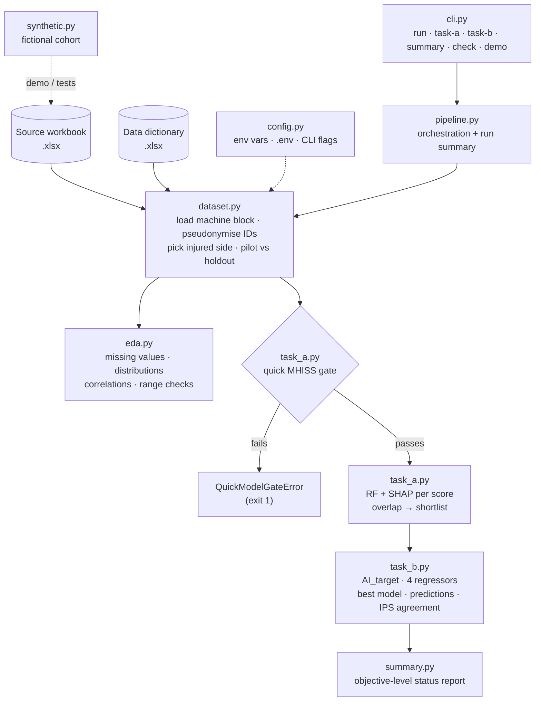
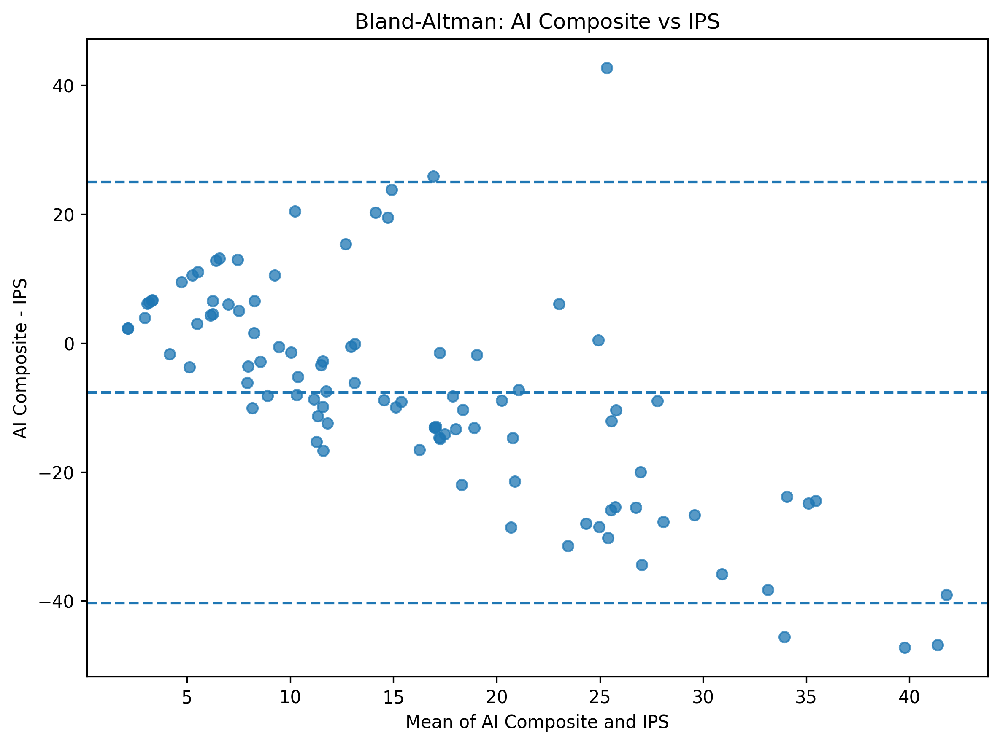

# Hand Injury AI: SHAP feature importance and AI composite score

**An explainable machine-learning pipeline that finds which clinical findings drive
established hand-injury severity scores, and learns a single AI composite score from
them.**


> **Status: research prototype.** Every number below comes from a 99-patient pilot
> cohort. These are pilot results, not clinical validation, and the pipeline is not a
> medical device.

## Contents

- [Overview](#overview)
- [Screenshots](#screenshots)
- [Key features](#key-features)
- [How it works](#how-it-works)
- [Tech stack](#tech-stack)
- [Architecture](#architecture)
- [Project structure](#project-structure)
- [Getting started](#getting-started)
- [Configuration](#configuration)
- [Input data format](#input-data-format)
- [Usage](#usage)
- [Outputs](#outputs)
- [Python API](#python-api)
- [Pilot results](#pilot-results)
- [Testing](#testing)
- [Linting and formatting](#linting-and-formatting)
- [Deployment](#deployment)
- [Data protection](#data-protection)
- [Troubleshooting and FAQ](#troubleshooting-and-faq)
- [Known limitations](#known-limitations)
- [Roadmap ideas](#roadmap-ideas)
- [Contributing](#contributing)
- [License](#license)

## Overview

Clinicians grade traumatic hand injuries with several severity systems that overlap
but don't agree: **MHISS** (Modified Hand Injury Severity Score), **Atthakomol**
(open-fracture infection risk), **MUES** (Mangled Upper Extremity Score) and
**Strickland** (flexor-tendon outcome). The outcomes that matter (infection, return
to work, amputation) take 6–12 months of follow-up, which a pilot study doesn't
have.

This project follows the "scores-as-targets" approach in
[`docs/technical_specification.pdf`](docs/technical_specification.pdf): the
validated scores stand in for long-term outcomes, and the pipeline answers two
questions.

1. **Task A: which findings drive each score?** For each score, a Random Forest is
   trained on the patients that score applies to, and SHAP values rank the input
   features. Features that rank highly for two or more scores form a shortlist.
2. **Task B: can one score summarise them?** The four scores are normalised and
   combined into a single 0–100 target. Four regressors are compared on the
   shortlisted features, and the resulting **AI composite** is compared with the
   **IPS** (Injury Prognosis Score) using scatter and Bland–Altman analysis.

**Who it's for:** clinical researchers and data scientists working with a hand-trauma
registry laid out like the project's workbook, who want reproducible, explainable
feature rankings and a composite score that can be audited, not a black box.

## Screenshots

All screenshots come from the real CLI, run on the **synthetic, fictional cohort** that
`hand-injury-ai demo` generates. No real patient data was used. The synthetic data is
deliberately simple, so its model metrics (R² ≈ 1.0) mean nothing clinically. For real
pilot results, see [Pilot results](#pilot-results).

**One-command demo.** `hand-injury-ai demo` writes a synthetic workbook, runs both
tasks, and ends with a recap of the run:



**Configuration check.** `hand-injury-ai check` shows where every input resolves to and
how to fix anything missing, without running the pipeline:

| Inputs missing | Ready to run |
|---|---|
|  |  |

**Generated figures (synthetic run).** One SHAP summary plot per score, plus the AI-vs-IPS
agreement plots:

<p>
  
  
</p>

<details>
<summary>Full <code>--help</code> output</summary>



</details>

## Key features

- **Bilateral → unilateral cohort building.** The workbook stores left- and right-hand
  findings side by side. A row joins the pilot cohort only when three independent
  records of the injured side agree (the form answer, the machine hand code and the
  dominance-based answer), the injured side has findings, and the other side has none.
  Every other row, bilateral injuries included, goes to a holdout table with a
  machine-readable reason.
- **Clinically gated subsets.** Atthakomol is modelled only for open fractures, MUES
  only for mangled injuries (≥ 3 injured tissue domains), Strickland only for digit
  injuries.
- **Sanity gate.** A quick MHISS model has to beat a mean baseline with a positive R²
  before the full SHAP run starts. This catches side-selection and feature-filtering
  mistakes early.
- **SHAP explanations.** A summary plot plus top-5 dependence plots per score, long and
  wide ranking tables, and a cross-score overlap table.
- **AI composite score.** Weighted MHISS 0.30, Atthakomol 0.25, Strickland 0.25,
  MUES 0.20, renormalised per patient over the scores that apply. Linear, Ridge
  (CV-tuned), Random Forest and XGBoost regressors are compared, and the best one is
  saved with both in-sample **and** out-of-fold predictions.
- **De-identification by default.** Only the machine-readable block of the workbook is
  read, and hospital IDs are replaced with pseudonyms (keyed HMAC-SHA256 if you set a
  salt) before anything is written.
- **EDA artefacts.** A missing-value summary and heatmap, target distributions, a
  Spearman feature–target heatmap, and range checks against the data dictionary.
- **Friendly CLI.** `demo` (try it with no data), `check` (find configuration
  problems), path flags that override environment variables, clear error messages
  that name the setting to fix, an end-of-run recap, and documented exit codes.

## How it works

| Stage | What happens | Key settings |
|---|---|---|
| Load | Read the machine-readable block (from `patient_id` onwards), copy in three form answers used to cross-check the side, and pseudonymise IDs | `HAND_INJURY_PATIENT_ID_SALT` |
| Cohort | Pick the injured side, collapse `_l`/`_r` columns into one set, and route rows to pilot or holdout | Three-way side agreement; opposite side must be clean |
| EDA | Missing values, distributions, Spearman heatmap, range checks against the dictionary | Writes to `outputs/eda/` |
| Gate | Quick Random Forest on MHISS vs a `DummyRegressor` mean baseline | Must have R² > 0 and beat the baseline |
| Task A | Per score: 80/20 stratified split, Random Forest (500 trees, `min_samples_leaf=5`), 5-fold CV, SHAP on the test split, rank by mean \|SHAP\| | Scores with < 10 applicable rows are skipped |
| Shortlist | Count how many scores each feature reaches the top 15 for; ≥ 2 means shortlisted | `TOP_K_FOR_OVERLAP = 15` |
| Task B | Map shortlisted encoded features back to raw columns; top up to 10 with Spearman correlates (max 15); compare 4 regressors | 80/20 split + CV; best by test R², then MAE |
| Agreement | AI composite vs IPS: scatter, Bland–Altman, MAE/RMSE/bias | `AI_composite_oof` gives honest estimates |

**AI target construction.** Each score is scaled to 0–100 by its maximum, and the base
weights are renormalised over the scores available for that patient:

| Score | Column | Max used for scaling | Base weight |
|---|---|---:|---:|
| MHISS | `mhiss_total` | 500 | 0.30 |
| Atthakomol | `attha_score` | 9 | 0.25 |
| Strickland | `strick_max` | 18 | 0.25 |
| MUES | `mues_score` | 8 | 0.20 |

## Tech stack

| Area | Tools |
|---|---|
| Language | Python 3.11+ (CI runs 3.11 and 3.13) |
| Data | pandas, NumPy, openpyxl (Excel I/O), tabulate (Markdown tables) |
| Modelling | scikit-learn (Random Forest, Ridge, pipelines, CV), XGBoost, SciPy (Spearman) |
| Explainability | SHAP (`TreeExplainer`) |
| Plots | matplotlib, seaborn |
| Packaging | setuptools via `pyproject.toml`, console script `hand-injury-ai` |
| Quality | pytest + pytest-cov, Ruff (lint + format), GitHub Actions workflow in `.github/workflows/ci.yml` |

## Architecture



`common.py` holds the logic both tasks share: subset flags, signal parsing,
stratification helpers and pseudonymisation.

## Project structure

```
.
├── src/hand_injury_ai/
│   ├── __init__.py         # package version
│   ├── __main__.py         # enables `python -m hand_injury_ai`
│   ├── cli.py              # argparse CLI: run, task-a, task-b, summary, check, demo
│   ├── config.py           # Paths dataclass; env vars, .env loading, output layout
│   ├── common.py           # shared case flags, signal parsing, stratification, pseudonyms
│   ├── dataset.py          # workbook/dictionary loading, injured-side selection, cohort split
│   ├── eda.py              # exploratory tables and plots
│   ├── task_a.py           # quick gate, Random Forest + SHAP per score, overlap shortlist
│   ├── task_b.py           # AI target, feature mapping, model comparison, agreement plots
│   ├── pipeline.py         # Task A → Task B orchestration, single_file_run_summary.json
│   ├── summary.py          # objective-level status report (JSON + Markdown)
│   └── synthetic.py        # fully fictional workbook + dictionary (demo and tests)
├── tests/                  # pytest suite, synthetic data only
│   ├── conftest.py         # `synthetic_paths` fixture
│   ├── test_cli.py         # help/version, check, path overrides, demo
│   ├── test_common.py      # parsing, flags, stratification, pseudonymisation
│   ├── test_config_and_summary.py
│   ├── test_dataset.py     # cohort routing rules
│   ├── test_task_a.py      # SHAP matrix reduction, overlap ranking, gate
│   ├── test_task_b.py      # AI target weights, feature mapping/top-up
│   └── test_end_to_end.py  # full pipeline on the synthetic cohort
├── data/                   # local inputs, git-ignored (see data/README.md)
├── docs/
│   ├── technical_specification.pdf  # project specification
│   ├── results/            # aggregate result tables from the April 2026 pilot run
│   ├── figures/            # selected plots from the pilot run
│   └── screenshots/        # README screenshots (synthetic demo run)
├── all_in_one_pipeline.py  # compatibility wrapper → hand-injury-ai run
├── script.py               # compatibility wrapper → hand-injury-ai summary
├── pyproject.toml          # package metadata, dependencies, Ruff and pytest config
├── .env.example            # documented configuration template
└── .github/workflows/ci.yml
```

## Getting started

### Prerequisites

- **Python 3.11 or newer** (`python3 --version`)
- `pip` and `venv` (bundled with Python; on Debian/Ubuntu you may need `sudo apt install python3-venv`)
- About 1 GB of disk space for dependencies (SHAP, XGBoost, scikit-learn)
- For real analyses: the source workbook and data dictionary (not in this repository;
  see [`data/README.md`](data/README.md)). You don't need them to try the demo.

### Installation

```bash
# 1. Clone
git clone https://github.com/jeevithg090/SHAP-Project.git
cd SHAP-Project

# 2. Create and activate a virtual environment
python3 -m venv .venv
source .venv/bin/activate            # Windows: .venv\Scripts\activate

# 3. Install the package (add [dev] for tests and linting)
pip install -e ".[dev]"              # or: pip install -e .   (runtime only)

# 4. Confirm the CLI is on your PATH
hand-injury-ai --version             # hand-injury-ai 1.0.0
```

### Quick start (no real data needed)

```bash
hand-injury-ai demo                  # ~35 s: writes demo/data/*.xlsx and runs everything
cat demo/outputs/task_b/B7_task_b_summary.md    # start here: model comparison + features
```

`demo/` is git-ignored. Use `--dir`, `--patients` (≥ 40) and `--seed` to change the
location, cohort size and randomness, or `--no-run` to write only the synthetic inputs.

### Run on your own data

```bash
cp .env.example .env                 # then edit the paths (and optionally the salt)
# put the workbook and data dictionary in data/, or point .env at them
hand-injury-ai check                 # confirm every input resolves (exit 0 = ready)
hand-injury-ai run                   # Task A + Task B, ≈1 min on the pilot data
```

## Configuration

Settings are read from, in order of precedence: **CLI flags → environment variables →
a `.env` file in the project root → built-in defaults.** Relative paths resolve
against `HAND_INJURY_PROJECT_ROOT` (the current directory by default).

| Variable | CLI flag | Required? | Default | Description |
|---|---|---|---|---|
| `HAND_INJURY_WORKBOOK_PATH` | `--workbook` | Yes, for `run`, `task-a` (or the file at the default path) | `data/Version 2- MIT calculation table.xlsx` | Source registry workbook, one row per patient |
| `HAND_INJURY_DATA_DICTIONARY_PATH` | `--dictionary` | Yes, for `run`, `task-a` (or the file at the default path) | `data/Data_Dictionary_v3.xlsx` | Workbook with a `Data Dictionary` sheet |
| `HAND_INJURY_OUTPUT_DIR` | `--output-dir` | No | `outputs` | Generated datasets, tables, figures and model |
| `HAND_INJURY_REPORTS_DIR` | `--reports-dir` | No | `reports` | Run summaries (JSON / Markdown) |
| `HAND_INJURY_FEATURE_LIST_PATH` | none | No | *(unset)* | Curated CSV with a `feature_name` column; Task B uses it instead of the Task A shortlist |
| `HAND_INJURY_PATIENT_ID_SALT` | none | No | *(unset)* | Secret for keyed HMAC-SHA256 pseudonyms (re-linkable by the custodian). Without it IDs become `P0001`, `P0002`, … Treat it like a password |
| `HAND_INJURY_PROJECT_ROOT` | none | No | current directory | Base for relative paths and location of `.env` |

To generate a salt: `python -c "import secrets; print(secrets.token_hex(32))"`.
`hand-injury-ai check` reports whether a salt is set but never prints its value.

## Input data format

The full description is in [`data/README.md`](data/README.md). In short:

- **Workbook:** one sheet, one row per patient. A human-readable form block comes first,
  followed by a machine-readable block starting at the `patient_id` column. Side-specific
  columns end in `_l` / `_r` (for example `tendon_d1_l`, `mhiss_total_r`). Score columns:
  `mhiss_total`, `attha_score`, `attha_type`, `mues_score`, `strick_max`, `ips_total`
  (per side). The form columns `Side Involved`, `Injured Hand` and `Dominance` are used
  to cross-check the side.
- **Data dictionary:** sheet `Data Dictionary` with at least `Column Name` and `Layer`
  (`input` / `target`). `Data Type` (`binary`, `categorical`, `integer`, `continuous`, …)
  and `Allowed Values / Range` (for example `0-120`) are used when present.

To see a valid example, run `hand-injury-ai demo --no-run` and open the two files in
`demo/data/`. They are built by
[`src/hand_injury_ai/synthetic.py`](src/hand_injury_ai/synthetic.py).

## Usage

### Commands

| Command | What it does | Needs |
|---|---|---|
| `hand-injury-ai demo` | Writes a synthetic cohort to `demo/data/` and runs the full pipeline into `demo/outputs/`, `demo/reports/` | nothing |
| `hand-injury-ai check` | Prints the resolved configuration and what's missing; exit 1 if a required input is absent | nothing |
| `hand-injury-ai run` | Task A + Task B end to end; always writes `single_file_run_summary.json` | workbook, dictionary |
| `hand-injury-ai task-a` | Cohort, EDA, quick gate, SHAP rankings, shortlist | workbook, dictionary |
| `hand-injury-ai task-b` | AI composite model from existing Task A outputs | Task A outputs |
| `hand-injury-ai summary [--run-pipeline]` | Objective-level status report from existing outputs (optionally runs the pipeline first) | outputs (optional) |
| `python -m hand_injury_ai …` | Same as `hand-injury-ai …` | |
| `python all_in_one_pipeline.py` | Backwards-compatible alias for `run` | |
| `python script.py [--run-pipeline]` | Backwards-compatible alias for `summary` | |

Every command accepts `-v/--verbose` (debug logging with module names) or
`-q/--quiet` (warnings, errors and the final recap only), and `--help`.

**Exit codes:** `0` success · `1` missing/invalid input, failed gate or failed run ·
`2` invalid command-line usage · `130` interrupted with Ctrl-C.

### Examples

```bash
# Point at files elsewhere without editing .env
hand-injury-ai run --workbook ~/secure/registry.xlsx --dictionary ~/secure/dictionary.xlsx \
                   --output-dir ~/secure/outputs --reports-dir ~/secure/reports

# Re-run only Task B with a curated feature list
HAND_INJURY_FEATURE_LIST_PATH=my_features.csv hand-injury-ai task-b

# Larger synthetic cohort in a scratch folder, quiet output
hand-injury-ai demo --dir /tmp/hand-demo --patients 200 --seed 1 -q

# Status report for the demo outputs
hand-injury-ai summary --output-dir demo/outputs --reports-dir demo/reports
```

Sample output of the last command (synthetic demo):

```text
Summary JSON:     demo/reports/script_objective_summary.json
Summary Markdown: demo/reports/script_objective_summary.md
Overall status:   completed
```

### Walkthrough: reading a run

1. **Check the cohort.** The log line `Cohort built: N rows -> P unilateral pilot, H holdout`
   and `outputs/eda/row_counts.csv` show how many rows were kept.
   `outputs/pilot_holdout_rows.csv` lists every excluded row with a `holdout_reason`
   (`bilateral_case`, `side_involved_machine_injured_hand_mismatch`, …), and
   `manual_side_verification.csv` has 10 rows to spot-check by hand.
2. **Check the data.** `outputs/eda/anomaly_report.csv` lists values outside the
   dictionary's allowed ranges.
3. **Read Task A.** `outputs/task_a/model_performance.csv` has test and CV metrics per
   score. `feature_ranking_wide.csv` and the `*_shap_summary.png` plots show what drives
   each score, and `overlap_analysis.csv` shows which features matter across scores.
4. **Read Task B.** Start with `outputs/task_b/B7_task_b_summary.md`. `B1` compares the
   models, `B3` gives the best model's weights or importances, and `B4` holds per-patient
   predictions (use `AI_composite_oof` for agreement analysis).
5. **Record status.** `hand-injury-ai summary` writes
   `reports/script_objective_summary.{json,md}` with the status of each objective and
   AI-vs-IPS agreement metrics (n, MAE, RMSE, mean difference, % within 5 / 10 points).

## Outputs

`outputs/` and `reports/` are git-ignored: they're regenerated on every run, and the
row-level files derive from patient records.

| Path | Contents |
|---|---|
| `outputs/pilot_model_input.csv` | Unilateral pilot cohort (pseudonymised), one row per patient |
| `outputs/pilot_holdout_rows.csv` | Excluded rows with `holdout_reason` |
| `outputs/manual_side_verification.csv` | 10 rows for manual side checks |
| `outputs/eda/` | `row_counts.csv`, `missing_value_summary.csv`, `missing_data_heatmap.png`, `target_distributions.png`, `spearman_feature_target_heatmap.png`, `anomaly_report.csv` |
| `outputs/task_a/` | `quick_mhiss_metrics.csv`, `model_performance.csv`, `feature_ranking_{long,wide}.csv`, `overlap_analysis.csv`, `default_feature_shortlist.csv`, `provisional_final_feature_list.csv`, `<score>_shap_summary.png`, `<score>_shap_dependence_<n>_<feature>.png` |
| `outputs/task_b/` | `B1_model_comparison.csv` · `B2_best_model.pkl` (joblib) · `B3_feature_weights.csv` · `B4_predictions_pilot.csv` (`AI_composite` in-sample, `AI_composite_oof` out-of-fold) · `B5_scatter_ai_vs_ips.png` · `B6_bland_altman_ai_vs_ips.png` · `B7_task_b_summary.md` · `task_b_selected_features.csv` · `task_b_run_summary.json` |
| `reports/run_summary.json` | Task A status, cohort counts, gate metrics, shortlist |
| `reports/single_file_run_summary.json` | Status of every `run` (`completed` / `failed` with the error) |
| `reports/script_objective_summary.{json,md}` | Objective-level report from `summary` |

To reuse the saved model:

```python
import json

import joblib
import pandas as pd

model = joblib.load("outputs/task_b/B2_best_model.pkl")  # fitted sklearn Pipeline
with open("outputs/task_b/task_b_run_summary.json", encoding="utf-8") as fh:
    features = json.load(fh)["selected_features"]
X = pd.read_csv("outputs/pilot_model_input.csv")[features]
scores = model.predict(X)  # AI composite on the 0-100 scale
```

## Python API

This is a batch pipeline, not a web service, so there are no HTTP endpoints. The
package can be driven from Python (for example from a notebook):

| Call | Returns | Description |
|---|---|---|
| `config.Paths.from_env(root=None)` | `Paths` | Resolve every input/output path from env vars and `.env` |
| `pipeline.run_full_pipeline(paths)` | `int` exit code | Task A + Task B, writes the run summary |
| `task_a.run(paths)` | `dict` summary | Task A only; raises `DataInputError` / `QuickModelGateError` |
| `task_b.run(paths)` | `dict` summary | Task B only; raises `TaskBInputError` |
| `summary.build_summary(paths)` / `summary.write_reports(report, dir)` | `dict` / `(json_path, md_path)` | Objective-level report |
| `synthetic.write_synthetic_inputs(dir, n_patients=90, seed=7)` | `(workbook, dictionary)` | Write a fictional cohort |

```python
from pathlib import Path
from hand_injury_ai import pipeline, synthetic
from hand_injury_ai.config import Paths

workbook, dictionary = synthetic.write_synthetic_inputs(Path("scratch/data"))
paths = Paths(
    workbook=workbook,
    data_dictionary=dictionary,
    output_dir=Path("scratch/outputs"),
    reports_dir=Path("scratch/reports"),
)
assert pipeline.run_full_pipeline(paths) == 0
```

## Pilot results

These come from the April 2026 run on the 119-patient workbook (99 unilateral pilot rows,
and 20 holdout rows, 6 of them bilateral). The tables are in
[`docs/results/`](docs/results) and the figures in [`docs/figures/`](docs/figures).

**Task A** (held-out 20% test split):

| Score | Subset | Rows | Test metric |
|---|---|---:|---|
| MHISS total | all pilot rows | 99 | R² 0.146 |
| Atthakomol type | open fractures | 51 | weighted F1 0.284, accuracy 0.455 |
| MUES | mangled injuries | 55 | R² 0.687 |
| Strickland max | digit injuries | 76 | R² 0.256 |

Thirteen features rank in the top 15 for at least two scores. Time from injury to
antibiotics, patient age and time to debridement lead the list.

**Task B:** Ridge regression was the best composite model (test R² 0.33, MAE 6.4 on the
0–100 scale; cross-validated R² 0.15). See
[`docs/results/task_b_model_comparison.csv`](docs/results/task_b_model_comparison.csv).

<p>
  
  
</p>

## Testing

```bash
pytest                               # full suite, ~1.5 min (includes two end-to-end runs)
pytest -m "not slow"                 # unit tests only, a few seconds
pytest --cov=hand_injury_ai --cov-report=term-missing   # with coverage (95% at last run)
```

The suite has 73 tests. It covers workbook parsing and canonical column names, the
cohort routing rules (bilateral, mismatched and clean-opposite-side cases),
pseudonymisation (sequential and keyed), subset flags, AI-target weight
renormalisation, feature mapping and Spearman top-up, SHAP matrix reduction, overlap
ranking, the quick gate, config/`.env` precedence, the summary report, CLI behaviour
(help, version, `check`, path overrides, `demo`, error exit codes) and full end-to-end
runs.

**The tests never touch real patient data.** Every fixture comes from
`hand_injury_ai.synthetic`, which generates fictional patients (`Synthetic Person N`,
IDs `9000NN`).

## Linting and formatting

```bash
ruff check .                         # lint (pycodestyle, pyflakes, isort, bugbear, pyupgrade, …)
ruff format --check .                # formatting check; drop --check to apply
python -m build                      # wheel + sdist in dist/
```

The Ruff configuration lives in `pyproject.toml` (line length 100, target Python 3.11).
The GitHub Actions workflow in [`.github/workflows/ci.yml`](.github/workflows/ci.yml)
runs install, lint, tests with coverage, the package build and a CLI smoke test on
Python 3.11 and 3.13.

## Deployment

This is a batch analysis pipeline, not a service, so "deploying" means running it where
the data is allowed to live (a lab workstation, a secure research server, a scheduled
job):

1. Install it on the target machine: `pip install .` (or build a wheel with
   `python -m build` and `pip install dist/hand_injury_ai-1.0.0-py3-none-any.whl`).
2. Provide the inputs through `HAND_INJURY_*` variables or CLI flags, and keep both
   inputs and outputs on storage approved for patient data.
3. Load `HAND_INJURY_PATIENT_ID_SALT` from your secret store, never from a committed file.
4. Run `hand-injury-ai check && hand-injury-ai run` and collect `outputs/` and
   `reports/`. The exit code tells a scheduler whether the run succeeded.

Matplotlib uses the non-interactive `Agg` backend, so the pipeline runs headless
(servers, cron, containers).

## Data protection

- Never commit the source workbook, the data dictionary or anything under `outputs/`.
  `.gitignore` blocks spreadsheets, CSVs (except `docs/results/`), model pickles and the
  generated folders.
- Only the machine-readable block is loaded, and patient names never reach the outputs.
  Hospital IDs are pseudonymised right after loading.
- Pseudonyms from a salted run can be mapped back to hospital IDs only by someone who
  holds the salt.
- Use `hand-injury-ai demo` (synthetic data) for screenshots, bug reports, teaching and
  examples.

## Troubleshooting and FAQ

**`Source workbook not found at '…'. Place the file there or set HAND_INJURY_WORKBOOK_PATH.`**
The workbook isn't where the configuration points. Run `hand-injury-ai check` to see
the resolved path, then fix `.env` or pass `--workbook`. Relative paths resolve
against the current directory (or `HAND_INJURY_PROJECT_ROOT`), so run the command from
the project root.

**`Could not find the machine-readable block: no 'patient_id' column in the workbook.`**
The pipeline starts reading at the `patient_id` column. Check the header spelling.
Matching ignores case, spaces and punctuation, so `Patient ID` works.

**`Data dictionary is missing required columns: ['layer']`** (or a missing sheet).
The dictionary needs a sheet named exactly `Data Dictionary` with `Column Name` and
`Layer` columns. Compare it with `demo/data/synthetic_dictionary.xlsx`.

**`Quick MHISS sanity check failed …`**
The quick MHISS model couldn't beat a mean baseline, which usually means the
injured-side columns or the dictionary layers are wrong (for example scores marked as
`input`). Look at `reports/run_summary.json` and `outputs/manual_side_verification.csv`.

**`Pilot dataset missing … Run Task A first.`**
`task-b` reads Task A's outputs. Run `hand-injury-ai task-a` (or `run`) with the same
`--output-dir`.

**`Skipping <score>: only N applicable rows` warning.**
Fewer than 10 patients qualify for that score's subset, so it's skipped and the rest of
the run continues.

**`hand-injury-ai: command not found`.**
Activate the virtual environment (`source .venv/bin/activate`), or use
`python -m hand_injury_ai`.

**Installation fails building `shap` or `xgboost`.**
Upgrade pip first (`python -m pip install --upgrade pip`) so prebuilt wheels are used,
and make sure you're on 64-bit Python 3.11+.

**Why does the demo report R² ≈ 1.0?**
The synthetic scores are simple functions of the synthetic findings, so the models fit
them almost perfectly. The demo shows the workflow and outputs, not model quality.

**Can I re-identify a patient from the outputs?**
Not without the salt. Without a salt, IDs are sequential codes and the mapping isn't
stored anywhere.

## Known limitations

- Small pilot cohort: test splits have 11–20 rows, so the metrics are noisy.
- Task B selects features from Task A rankings computed on the same patients, and
  `AI_composite` in `B4` is an in-sample fit. Use `AI_composite_oof` for honest agreement
  estimates.
- Possible target leakage to review: the MHISS modifier columns (`integument_mod`,
  `skeletal_mod`, `motor_mod`, `nv_mod`) are model inputs and may feed directly into the
  MHISS score.
- The AI composite (0–100) and IPS are on different scales, so Bland–Altman
  differences describe calibration as much as agreement.
- The workbook layout (machine block starting at `patient_id`, `_l`/`_r` suffixes) is
  assumed. Other registries need a mapping step first.
- CI runs on Ubuntu only, so Windows and macOS are untested.
- External validation needs a prospective dataset with the same schema.

## Roadmap ideas

- Nested cross-validation for the feature shortlist, to remove the selection bias in Task B.
- Rescale the AI composite to the IPS range (or report a calibrated version) before
  agreement analysis.
- A configurable leakage exclusion list for score-component columns.
- An HTML report that collects the key tables and plots from a run.
- Score new patients with the saved `B2` model through a `predict` command.

## Contributing

1. Fork the repository and create a branch: `git checkout -b feat/short-description`.
2. Install the dev extras: `pip install -e ".[dev]"`.
3. Make your change and add tests. **Use only synthetic data** (`hand_injury_ai.synthetic`).
   Never attach real workbooks, outputs or screenshots of them to issues or pull requests.
4. Run `ruff check . && ruff format --check . && pytest` before you push.
5. Open a pull request that describes what changed and how you verified it. Use
   [Conventional Commits](https://www.conventionalcommits.org/) messages (`feat:`, `fix:`,
   `docs:`, …).

## License

This repository doesn't have a license yet, so all rights are reserved by default.
Because it includes institutional documents (`docs/technical_specification.pdf` and the
pilot results), check with the department or data custodian before choosing one. For
the code alone, **MIT** or **Apache-2.0** would be typical choices.
